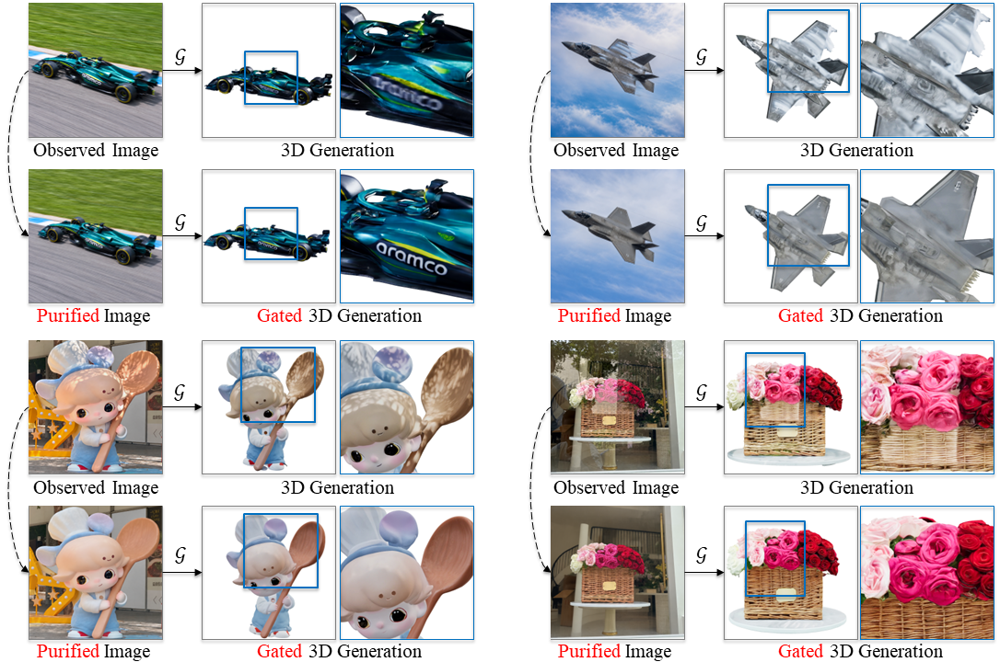

<h1 align="center">Gate3DGen: A Pre-processing Model that Selectively Purifies Real-World Images for 3D Generation</h1>

<p align="center">
  <a href="https://supra-3d.github.io/gate3dgen/"></a>
  <a href="https://arxiv.org/abs/2610.31649"></a>
  <a href="https://huggingface.co/hllee0615/gate3dgen"></a>
  <a href="LICENSE"></a>
</p>

<p align="center">
  <a href="https://orcid.org/0009-0005-6066-2131">Xiaolin Li</a><sup>1,2*</sup>,
  <a href="https://inso-13.github.io/">Zihao Huang</a><sup>2*</sup>,
  <a href="https://mfp0610.github.io/">Fanpeng Meng</a><sup>2</sup>,
  <a href="https://chensjtu.github.io/">Chen Yang</a><sup>2</sup>,<br>
  <a href="https://guanjunwu.github.io/">Guanjun Wu</a><sup>3,2</sup>,
  <a href="https://www.sigs.tsinghua.edu.cn/zk_en/main.htm">Kai Zhang</a><sup>1✉</sup>,
  <a href="https://jaminfong.cn/">Jiemin Fang</a><sup>2‡✉</sup>,
  <a href="https://www.qitian1987.com/">Qi Tian</a><sup>2✉</sup>
</p>

<p align="center">
  <sup>1</sup>Tsinghua University &nbsp;&nbsp;
  <sup>2</sup>Huawei Inc. &nbsp;&nbsp;
  <sup>3</sup>Huazhong University of Science and Technology<br>
  <sup>*</sup>Equal contribution &nbsp;&nbsp;
  <sup>‡</sup>Project lead &nbsp;&nbsp;
  <sup>✉</sup>Corresponding authors
</p>



*The same frozen 3D generator receives the observed image (top) or the purified image (bottom) in each example.*

**Gate3DGen** selectively purifies real-world images while bypassing inputs
classified as clean, improving downstream 3D generation without retraining the
3D generator.

- **Selective routing.** Classify an input as KEEP or PURIFY and preserve clean inputs.
- **One-step purification.** Restore selected images using the trained router's hidden states.
- **Frozen 3D generation.** Use the resulting image with a downstream 3D generator.

Learn more on the [project page](https://supra-3d.github.io/gate3dgen/), read the
[paper](https://arxiv.org/abs/2610.31649), or download the [model weights](https://huggingface.co/hllee0615/gate3dgen).

## Abstract

Single-image 3D generation has achieved high fidelity on curated benchmarks, yet degrades sharply on real-world images with uneven illumination, blur, and occlusions.
Purifying such inputs requires deciding when to intervene and preserving the visual cues needed for 3D generation, while leaving clean inputs unchanged.
We introduce **Gate3DGen**, a selective pre-processing model that gates image inputs to existing 3D generators without retraining them.
A degradation-aware router bypasses inputs classified as clean and extracts features to guide purification of the remaining inputs.
Conditioned on these features, a 3D-oriented one-step purifier purifies degraded inputs with spatial losses that encourage preservation of object identity, contours, and textural cues.
To provide paired supervision, we construct a synthetic data engine that renders clean views of 3D assets and synthesises composite degradations.
On the synthetic benchmark, the purifier improves image fidelity and downstream 3D geometry in only 2.3 s on average, reducing TRELLIS.2 mesh distance by 61.5% relative to degraded inputs.
VLM evaluation and human preferences on real photographs further support identity preservation and degradation correction.
More demos and code are available at [supra-3d.github.io/gate3dgen](https://supra-3d.github.io/gate3dgen/).

## 🛠️ Setup


```bash
GATE3DGEN_SKIP_UPSTREAM_DOWNLOAD=1 bash setup/setup.sh
conda activate gate3dgen
python setup/download_weights.py
python setup/check.py
```
The setup script creates or updates the Conda environment and prepares Blender.
The default stack is PyTorch 2.9.0 with CUDA 12.8 (`cu128`) on a compatible NVIDIA/Linux system.
`download_weights.py` downloads the complete GateB/router and restoration/purifier pair
with frozen runtime components; no FireRed-base reconstruction is needed for inference.
The default 3D demo additionally requires the [Pixal3D backend and auxiliary models](docs/weights.md#external-models).
Running `setup.sh` without the skip variable also downloads the complete upstream FireRed and Pixal3D repositories for existing workflows.

This source repository excludes checkpoint tensors. See the [weight download guide](docs/weights.md)
for core model access, external dependency requirements and the exact checkpoint layout.


## 🚀 Demo

```bash
python -m gate3dgen.demo assets/demo_01.png --output outputs/demo
```

The output includes the KEEP/PURIFY decision, the resulting image and before/after Pixal3D GLBs.

## 📁 Data

See [data preparation](docs/data.md) for synthesis, auditing and the example dataset.

## 🏋️ Training

```bash
python -m gate3dgen.training.cli train
```

See [training](docs/training.md) for data preparation and the router/purifier recipes.

## 📊 Evaluation

```bash
bash scripts/evaluate.sh
```

See [evaluation](docs/evaluation.md) for 2D, geometry and texture metrics, and new Pixal3D reconstructions.

## 📜 License

Original code is [Apache-2.0](LICENSE). We thank FireRed, Qwen and Pixal3D.
Models and example assets retain their [third-party licenses](THIRD_PARTY.md).

## Citation

```bibtex
@misc{li2026gate3dgenpreprocessingmodelselectively,
  title         = {Gate3DGen: A Pre-processing Model that Selectively Purifies Real-World Images for 3D Generation},
  author        = {Xiaolin Li and Zihao Huang and Fanpeng Meng and Chen Yang and Guanjun Wu and Kai Zhang and Jiemin Fang and Qi Tian},
  year          = {2026},
  eprint        = {2610.31649},
  archivePrefix = {arXiv},
  primaryClass  = {cs.CV},
  url           = {https://arxiv.org/abs/2610.31649}
}
```
