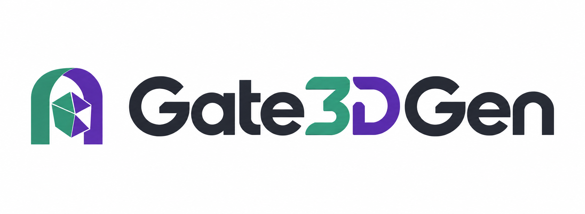

> **Source-only repository.** Complete original-precision inference weights are
> distributed separately on [Hugging Face](https://huggingface.co/hllee0615/gate3dgen).
> See the [weight download guide](docs/weights.md) for access checks, dependency links
> and the exact checkpoint layout. No checkpoint tensors are stored in this Git repository.



## ✨ A Pre-processing Model that Selectively Purifies Real-World Images for 3D Generation

### [Paper](docs/Gate3DGen.pdf) | YouTube (coming soon) | Page (coming soon)

[Xiaolin Li](https://orcid.org/0009-0005-6066-2131)<sup>1,2*</sup>, [Zihao Huang](https://inso-13.github.io/)<sup>2*</sup>, [Fanpeng Meng](https://mfp0610.github.io/)<sup>2</sup>, [Chen Yang](https://chensjtu.github.io/)<sup>2</sup>,  

[Guanjun Wu](https://guanjunwu.github.io/)<sup>3,2</sup>, [Kai Zhang](https://www.sigs.tsinghua.edu.cn/zk_en/main.htm)<sup>1✉</sup>, [Jiemin Fang](https://jaminfong.cn/)<sup>2✉‡</sup>, [Qi Tian](https://www.qitian1987.com/)<sup>2✉</sup>

*Equal contribution. ‡Project lead. ✉Corresponding authors.

1Tsinghua University · 2Huawei Inc. · 3Huazhong University of Science and Technology

*Gate3DGen selectively purifies real-world images while bypassing inputs classified as clean, improving downstream 3D generation without retraining the 3D generator.*


*Figure 1. The same frozen 3D generator receives the observed image (top) or the purified image (bottom) in each example.*

## 🛠️ Setup


```bash
GATE3DGEN_SKIP_UPSTREAM_DOWNLOAD=1 bash setup/setup.sh
conda activate gate3dgen
python setup/download_weights.py
python setup/check.py
```
The setup script creates or updates the Conda environment and prepares Blender.
The default stack is PyTorch 2.9.0 with CUDA 12.8 (`cu128`) on a compatible NVIDIA/Linux system.
`download_weights.py` downloads the complete GateB/router and restoration/purifier pair
with frozen runtime components; no FireRed-base reconstruction is needed for inference.
The default 3D demo additionally requires the [Pixal3D backend and auxiliary models](docs/weights.md#external-models).
Running `setup.sh` without the skip variable also downloads the complete upstream FireRed and Pixal3D repositories for existing workflows.


## 🚀 Demo

```bash
python -m gate3dgen.demo assets/demo_01.png --output outputs/demo
```

The output includes the KEEP/PURIFY decision, the resulting image and before/after Pixal3D GLBs.

## 📁 Data

See [data preparation](docs/data.md) for synthesis, auditing and the example dataset.

## 🏋️ Training

```bash
python -m gate3dgen.training.cli train
```

See [training](docs/training.md) for data preparation and the router/purifier recipes.

## 📊 Evaluation

```bash
bash scripts/evaluate.sh
```

See [evaluation](docs/evaluation.md) for 2D, geometry and texture metrics, and new Pixal3D reconstructions.

## 📜 License

Original code is [Apache-2.0](LICENSE). We thank FireRed, Qwen and Pixal3D.
Models and example assets retain their [third-party licenses](THIRD_PARTY.md).
