# In-the-wild examples

[Back to README](../README.md#demo)

The demo inputs are in [assets/](../assets). Selected screenshot borders and overlays have been
removed by rectangular cropping; retained pixels have not been retouched. Every image below
is an individual file. Purifier images were generated using the released checkpoint pair.
The displayed routing labels include the author's corrections: **demo_06, demo_08, and demo_09
are KEEP**, and their inputs are passed through unchanged without invoking the purifier.
These corrected labels are qualitative presentation labels, not newly measured router scores.
At runtime, the frozen threshold is **0.006440580124035478**; purification is triggered when
`p >= threshold`. The demo JSON records the actual model decision and probability.
These are qualitative examples without clean ground truth.
The examples illustrate both PURIFY and KEEP. Runtime decisions must be recomputed if an input
is cropped or otherwise changed.

| Case | Input | Router | Purified image / action |
|---|---|---|---|
| demo_01 | 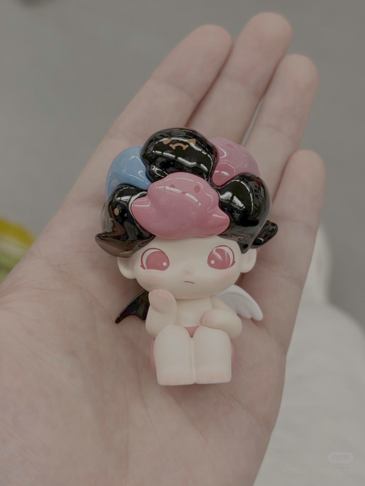 | **PURIFY** | 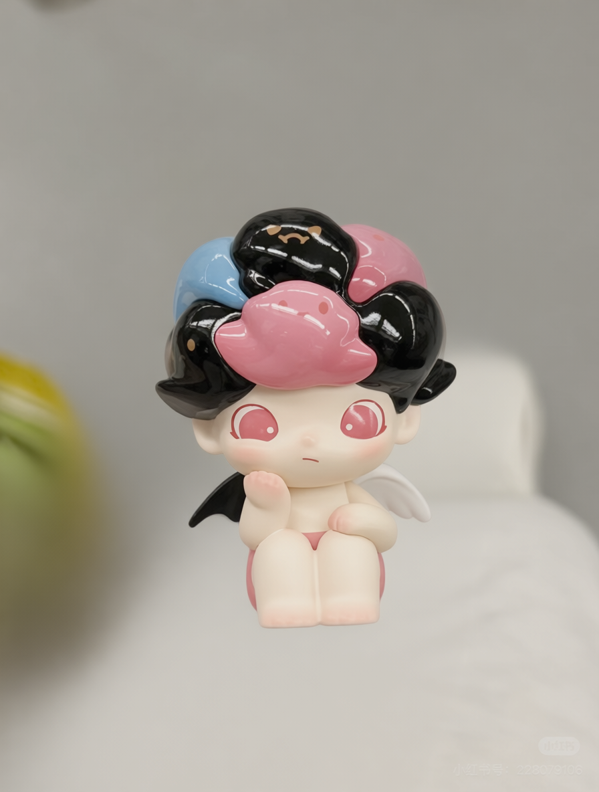 |
| demo_02 | 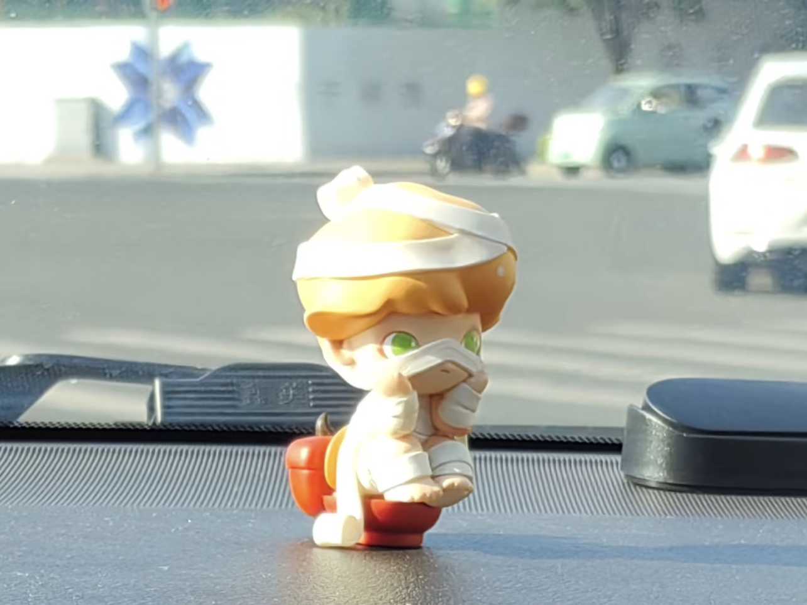 | **PURIFY** | 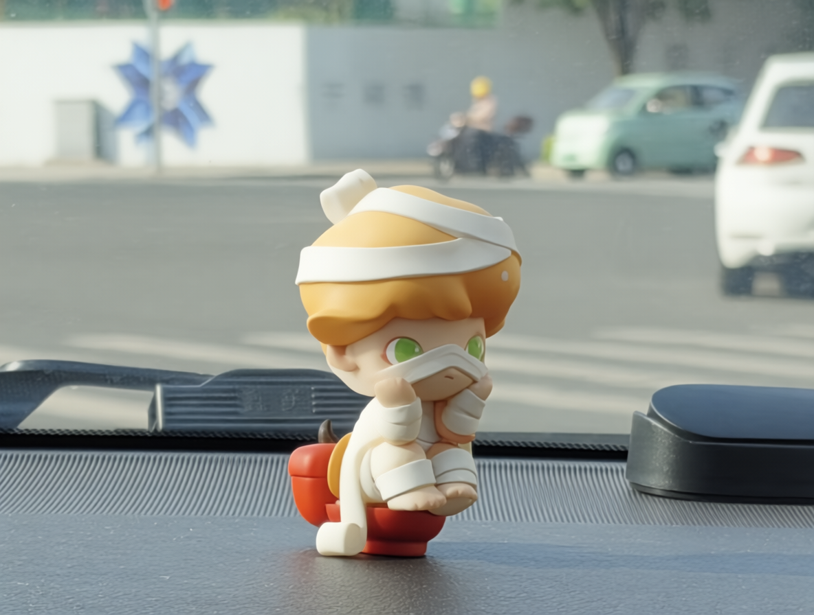 |
| demo_03 | 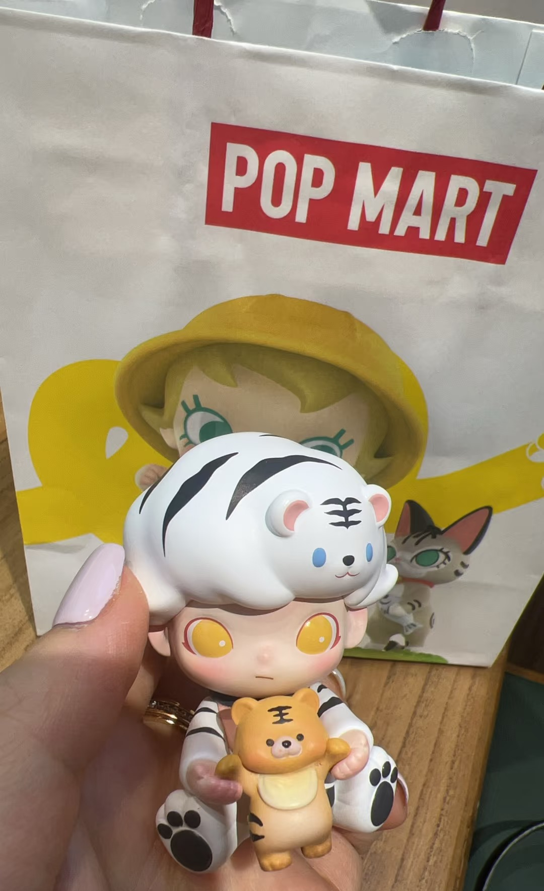 | **PURIFY** | 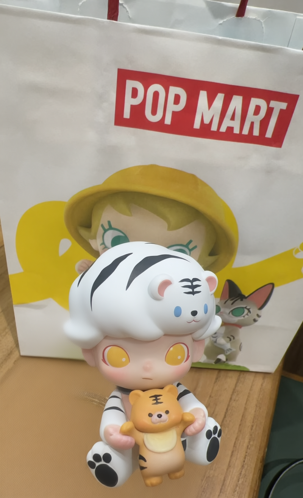 |
| demo_04 | 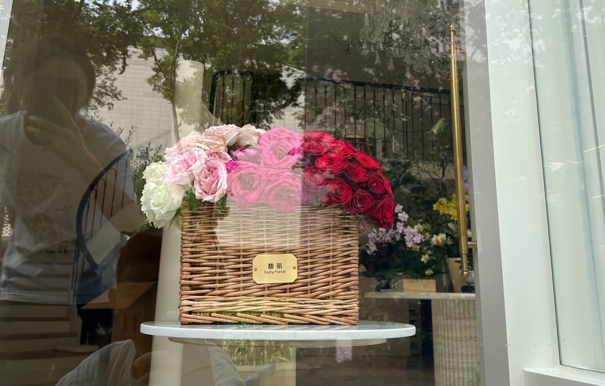 | **PURIFY** | 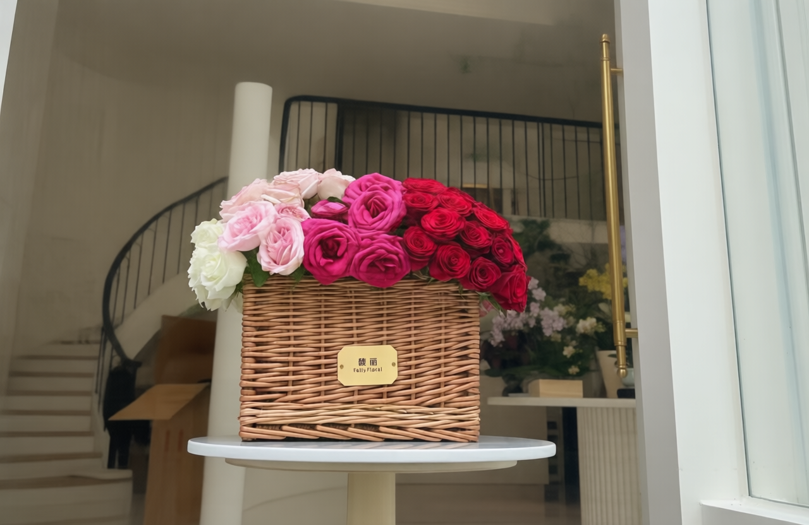 |
| demo_05 | 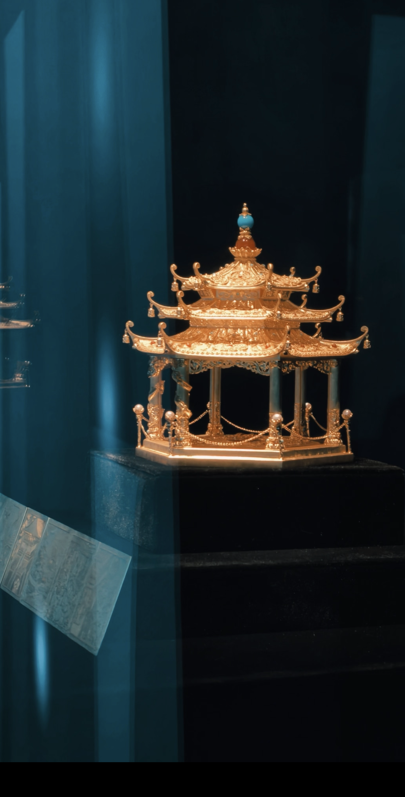 | **PURIFY** | 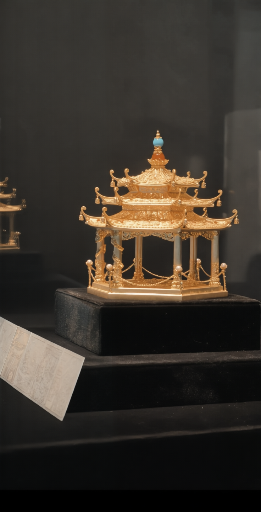 |
| demo_06 | 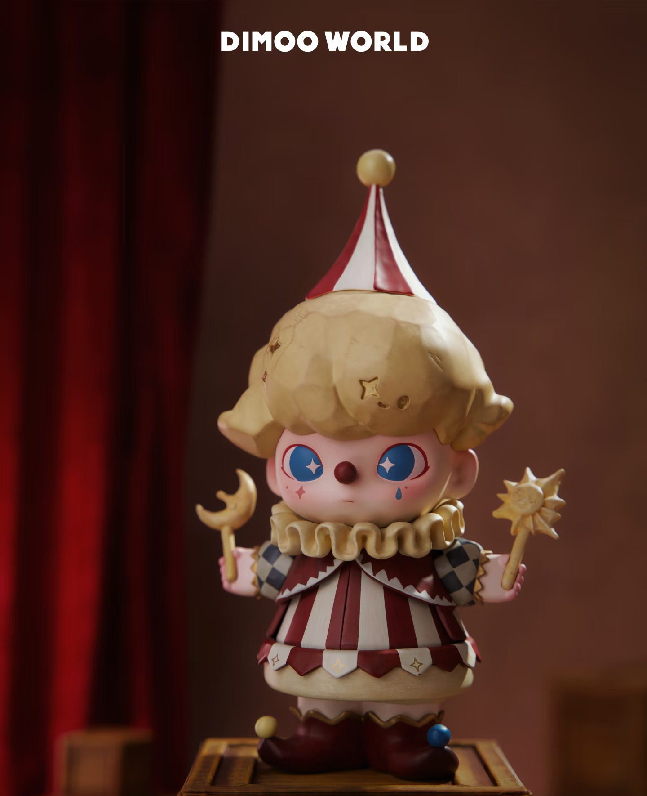 | **KEEP** | Input unchanged; purifier not invoked. |
| demo_07 | 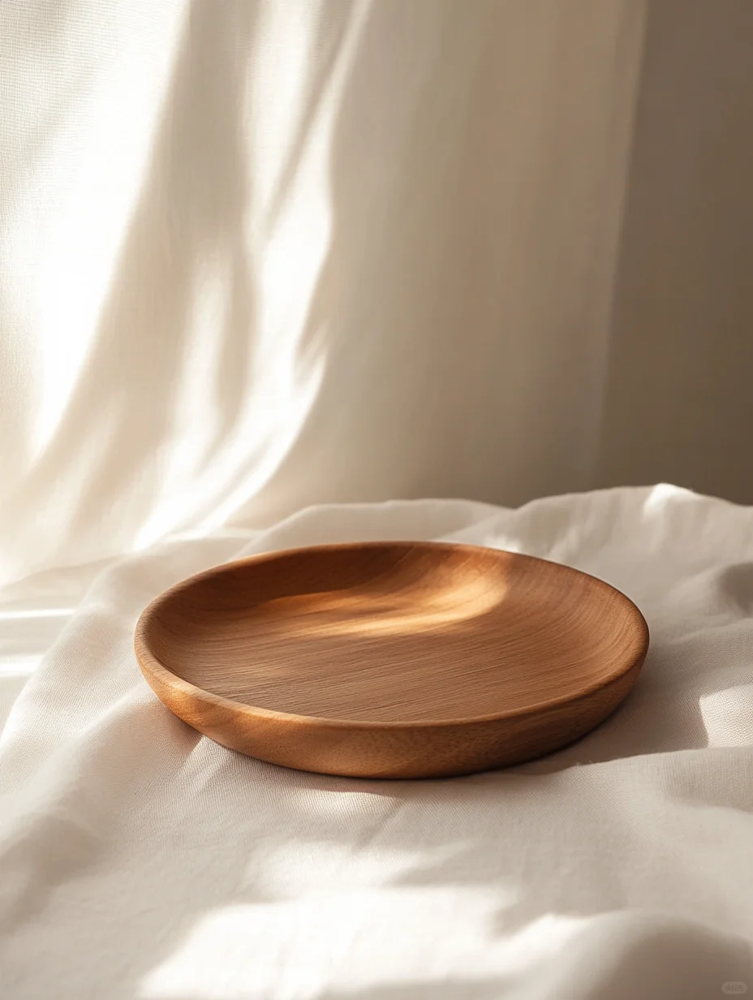 | **PURIFY** | 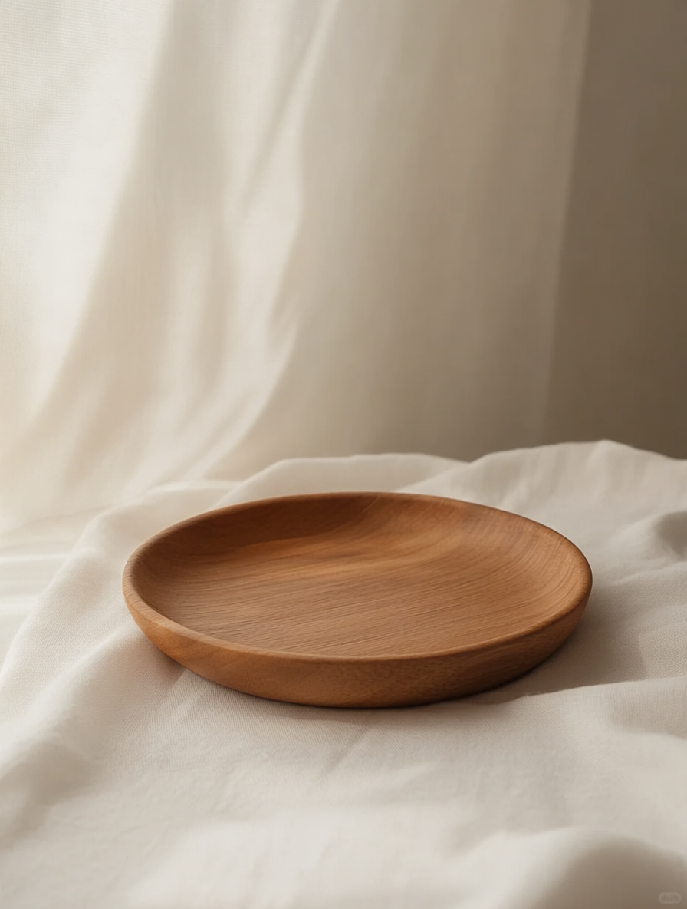 |
| demo_08 | 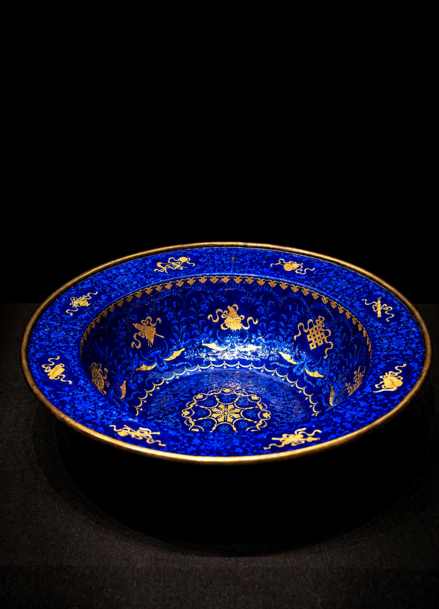 | **KEEP** | Input unchanged; purifier not invoked. |
| demo_09 | 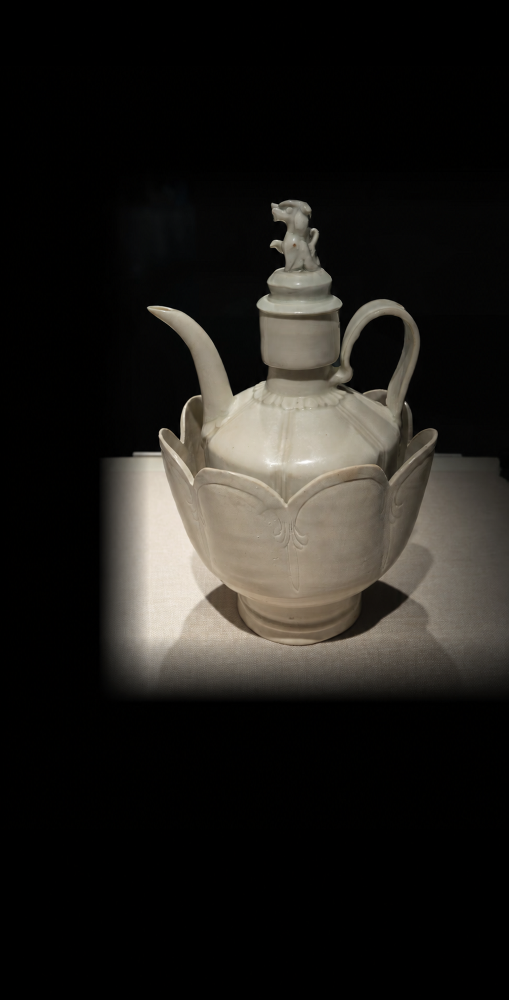 | **KEEP** | Input unchanged; purifier not invoked. |
